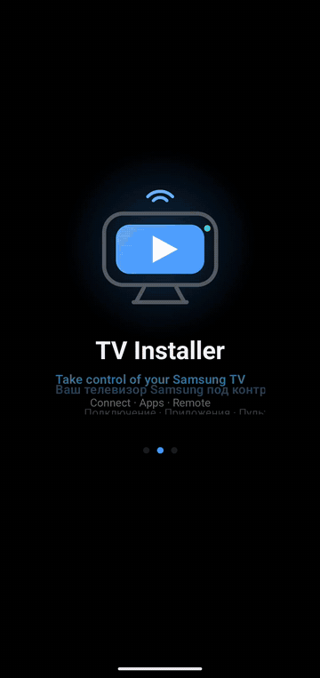
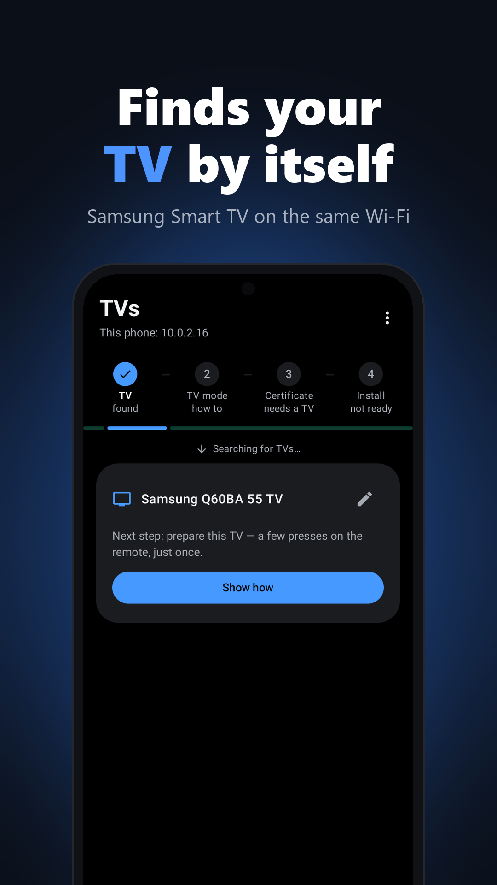
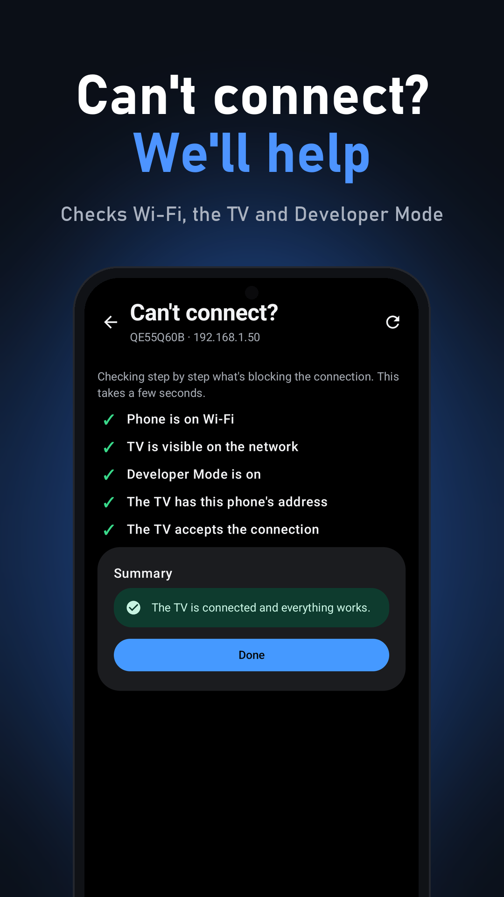
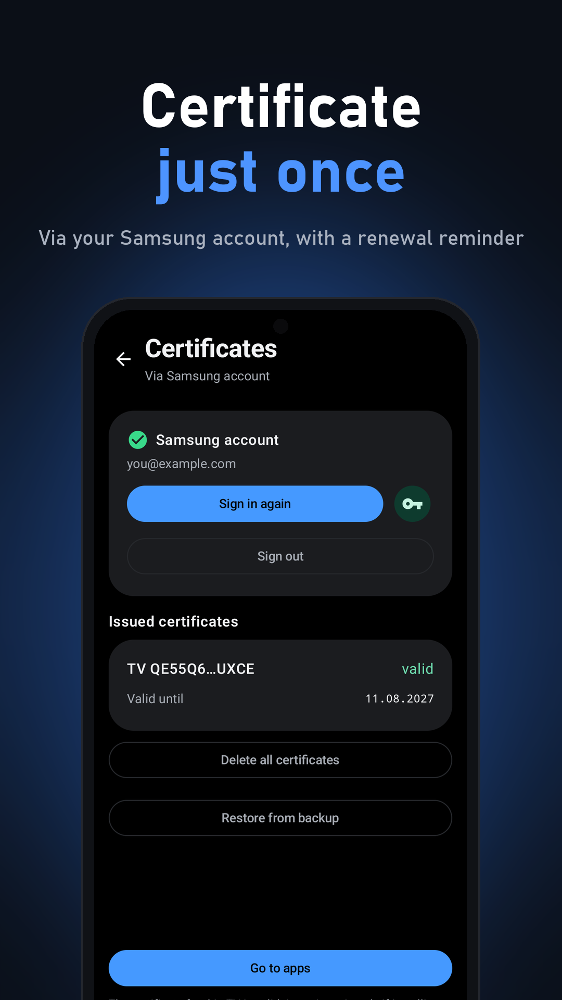
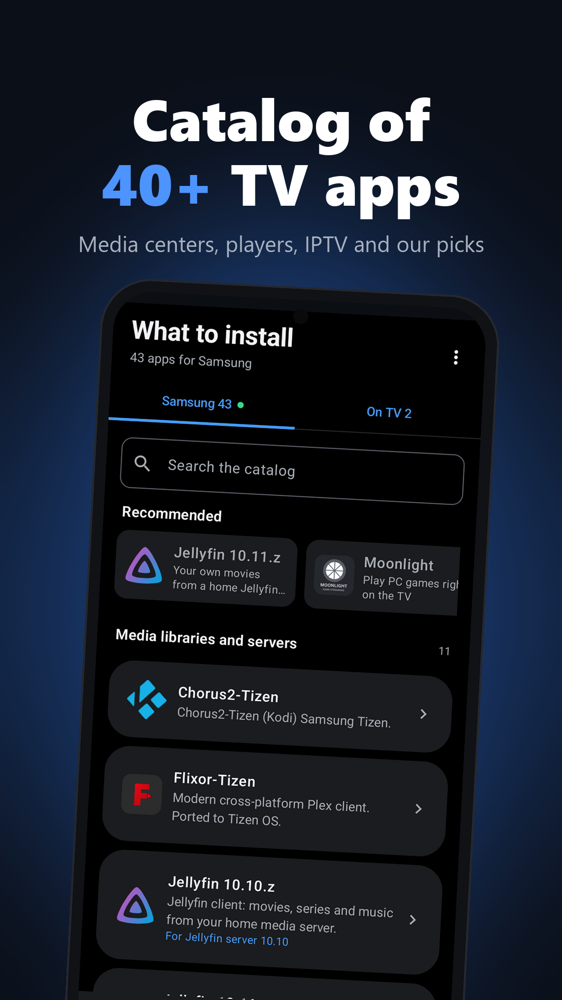
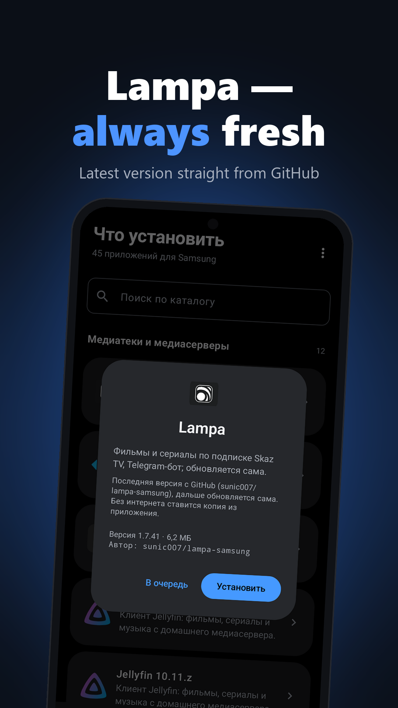
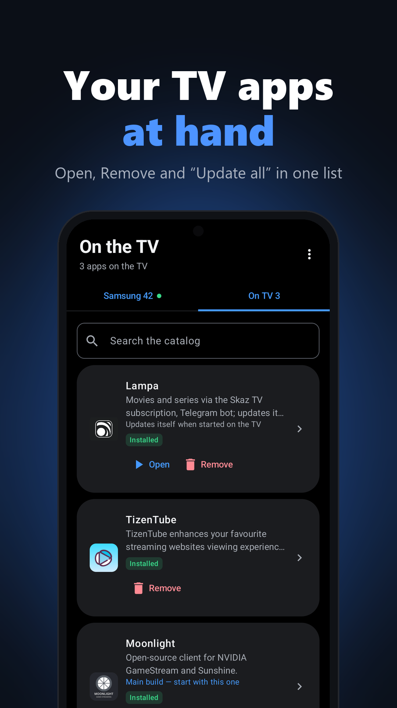
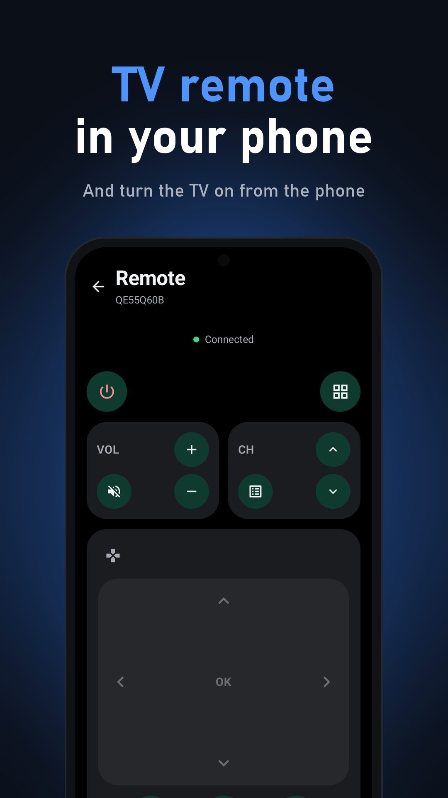
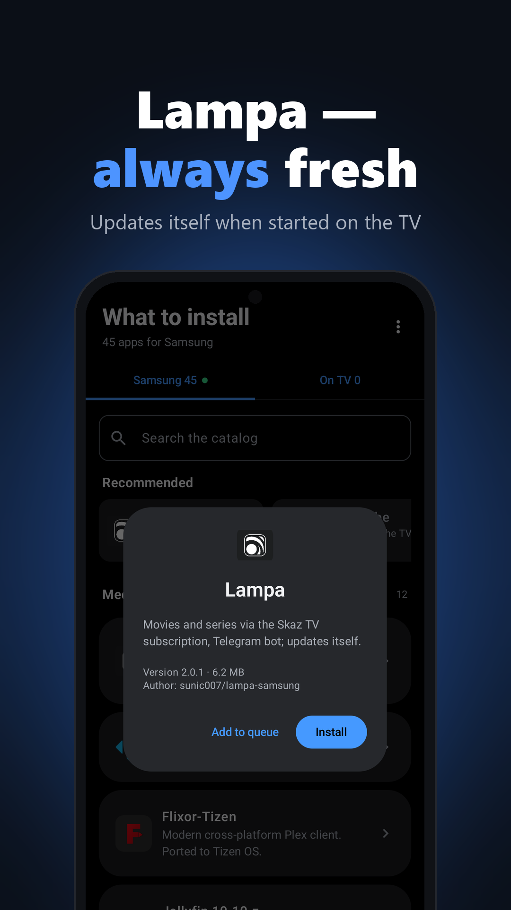
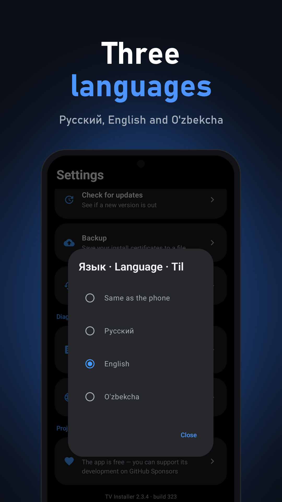

# TV Installer

Install apps on <b>Samsung Smart TV</b> straight from your phone — no PC, no Tizen Studio

   

[What's new](CHANGELOG.md) · [All versions](https://github.com/sunic007/tvinstaller/releases) · [Privacy](https://sunic007.github.io/tvinstaller/privacy.html) · ❤️ [Sponsor](https://github.com/sponsors/sunic007)

**English** · [Русский](README.ru.md) · [O'zbekcha](README.uz.md)

## How it works

<table>
<tr>
<td width="300" align="center" valign="top"></td>
<td valign="top">

📲 <b>1. Install the app</b> Download <b>SunicTvInstaller.apk</b> and open it on your Android phone.

🔑 <b>2. Sign in to Samsung</b> Once. The certificate for your TV is issued by Samsung automatically.

📺 <b>3. Prepare the TV</b> Turn on Developer Mode with your phone's address — a 1‑minute video guide is inside.

🔍 <b>4. Connect</b> The app finds the TV on your Wi‑Fi by itself.

✅ <b>5. Install</b> Pick an app from the catalog of 40+ and tap <b>Install</b>.

The app speaks <b>English, Russian and Uzbek</b> and follows your phone language.

▶ <b>Developer Mode</b> — 1‑min video 
Apps → App Settings → <code>1 2 3 4 5</code> → Developer mode <b>On</b> → phone's IP → <b>OK</b> → restart the TV

 

</td>
</tr>
</table>

  
  
  

More screenshots

  
  
  

  
  
  

## Features

- **Finds your TV automatically** on the same Wi‑Fi network; several TVs are supported.
- **"Can't connect?" wizard** checks Wi‑Fi, the TV, Developer Mode and the address set on the TV step by step — and
  tells you clearly when the TV is set up for another device (only one phone or PC can install on a Samsung TV at a time).
- **Video guide** on enabling Developer Mode on the TV, in English, Russian and Uzbek.
- **Samsung certificate just once** — sign in with your Samsung account; no PC or Tizen Studio. A reminder comes a
  month before it expires, renewal is one tap, and certificates can be backed up and **restored from a backup**.
- **Catalog of 40+ TV apps** — media centers, players, streaming, IPTV — with **Recommended** starter picks; or install
  your own `.wgt` file or link. Variants of one app (Jellyfin, Moonlight builds) are explained.
- **One tap to install**, every step visible, then **"Open on TV"**. The **On TV** list has **Open / Remove** and
  **Update all**; a daily notification tells you when updates are out.
- **TV remote** in the phone and **turning the TV on** from the phone (Wake-on-LAN).
- **[Lampa for Samsung](https://github.com/sunic007/lampa-samsung)** is installed straight from its latest GitHub
  release and then keeps itself up to date on the TV.
- **Updates itself without a browser**: downloads its new version, verifies it and opens Android's installer.

## Requirements

- An Android 7.0+ phone and a Samsung Smart TV with Tizen, on the same Wi‑Fi network (not a guest network).
- A free Samsung account (for the installation certificate).

## FAQ

**The TV is not found or won't connect.** Open the ⋮ menu → "Can't connect?" — the wizard checks everything step
by step. Also make sure the phone and the TV are on the same network and that Developer Mode on the TV has
*this phone's* IP. If the phone's IP changed, enter it again and restart the TV.

**Signing or installation error.** Remove the old version of the app from the TV and install again.

**Is it safe?** The app talks to the TV only inside your home network. It contacts Samsung only to issue the
certificate and GitHub only to download apps — see the [privacy policy](https://sunic007.github.io/tvinstaller/privacy.html).

## Disclaimer

TV Installer is an independent project and is not affiliated with or endorsed by Samsung. Samsung and Tizen are
trademarks of Samsung Electronics. The app uses the same certificate flow as Samsung's Tizen Studio: you sign in to
your own Samsung account, and the certificate is issued by Samsung for your TV. You are responsible for the apps you
install; the app does not host or provide any media content.

## Support the project

TV Installer is free. If it is useful to you, you can support its development on
**[GitHub Sponsors](https://github.com/sponsors/sunic007)** (in the app: Settings → Support the project).
