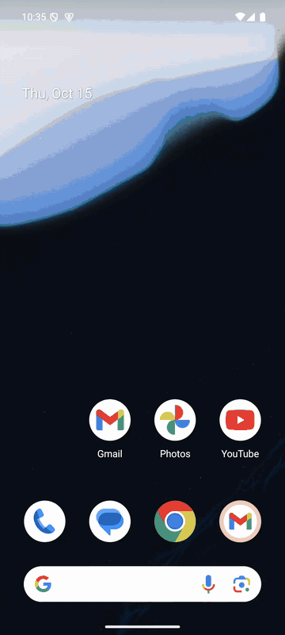
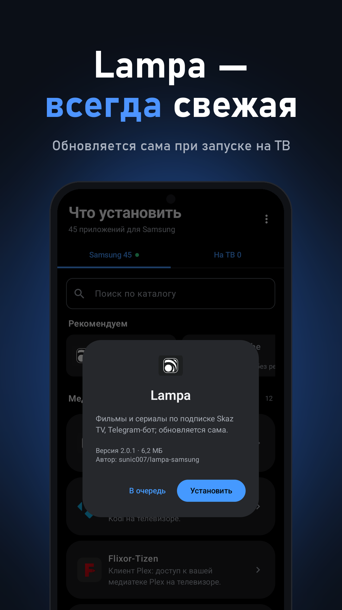
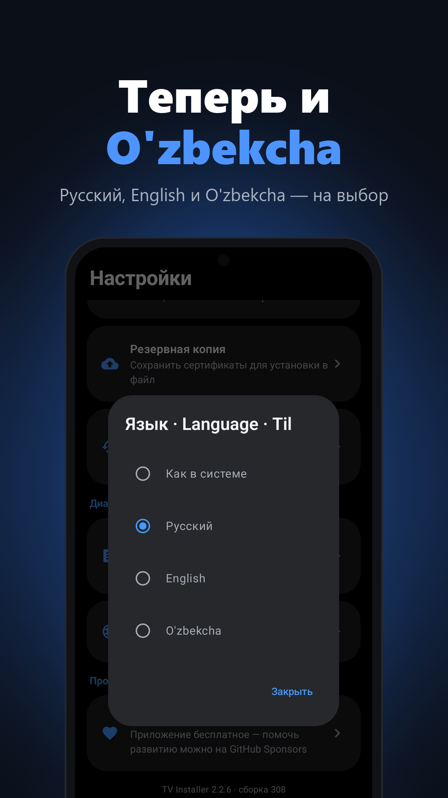

Установка приложений на <b>Samsung Smart TV</b> прямо с Android-телефона. Без компьютера, Tizen Studio и проводов.

Бесплатно · Android 7.0+ · <a href="CHANGELOG.md">Что нового</a> · <a href="https://sunic007.github.io/tvinstaller/privacy.html">Конфиденциальность</a>

<a href="README.md"> English</a> &nbsp;·&nbsp;  <b>Русский</b> &nbsp;·&nbsp; <a href="README.uz.md"> O'zbekcha</a>

 

## Как это работает

1. <b>Установите TV Installer</b> — скачайте APK по кнопке выше и откройте его на телефоне.
2. <b>Войдите в аккаунт Samsung</b> — один раз. Сертификат для телевизора Samsung выдаст сам.
3. <b>Подготовьте телевизор</b> — включите режим разработчика с адресом телефона. <a href="https://youtu.be/U4VGa0fGYUI">Видео на 1 минуту</a>.
4. <b>Подключитесь</b> — приложение само найдёт телевизор в вашей сети Wi‑Fi.
5. <b>Установите</b> — выберите приложение из каталога (40+) и нажмите <b>Установить</b>.

> **Режим разработчика на ТВ** 
> <b>Apps</b> → <b>App Settings</b> → на пульте <code>1 2 3 4 5</code> → <b>Developer mode: On</b> → IP телефона (он есть в приложении) → <b>OK</b> → перезагрузите телевизор.

 

## Скриншоты

  
  
  

<b>Ещё скриншоты</b>

 

  
  
  
  
  
  

## Возможности

- <b>Сам находит телевизор</b> — в той же сети Wi‑Fi; можно работать с несколькими ТВ.
- <b>Мастер «Не подключается?»</b> — по шагам проверяет Wi‑Fi, телевизор, режим разработчика и адрес на ТВ и прямо говорит, если телевизор настроен на другое устройство.
- <b>Сертификат Samsung один раз</b> — через аккаунт Samsung. Напоминание за месяц до окончания, продление в одно нажатие, резервная копия и восстановление.
- <b>Каталог из 40+ приложений</b> — медиатеки, плееры, стриминг, IPTV и подборка «Рекомендуем» — или свой файл <code>.wgt</code> и ссылка.
- <b>Установка в одно касание</b> — с каждым шагом на экране. В списке «На ТВ» — «Открыть», «Удалить» и «Обновить всё», раз в день — уведомление об обновлениях.
- <b>Пульт</b> — в телефоне и включение телевизора по сети (Wake‑on‑LAN).
- <b><a href="https://github.com/sunic007/lampa-samsung">Lampa для Samsung</a></b> — устанавливается из последнего релиза на GitHub и дальше обновляется на телевизоре сама.
- <b>Обновляется само</b> — без браузера: скачивает новую версию, проверяет её и открывает установку Android.

## Что нужно

- Телефон на Android 7.0+ и телевизор Samsung с Tizen в одной сети Wi‑Fi (не гостевой).
- Бесплатный аккаунт Samsung — для сертификата установки.

## Частые вопросы

<b>Телевизор не находится или не подключается</b>

 

Откройте меню ⋮ → <b>Не подключается?</b> — мастер проверит всё по шагам. Убедитесь, что телефон и телевизор в одной сети, а в режиме разработчика на ТВ указан IP <i>именно этого</i> телефона. Если IP телефона сменился, введите его заново и перезагрузите телевизор.

<b>Ошибка подписи или установки</b>

 

Удалите старую версию приложения с телевизора и установите его заново.

<b>Это безопасно?</b>

 

С телевизором приложение общается только внутри домашней сети. К Samsung оно обращается только за сертификатом, к GitHub — только за приложениями. Подробнее — в <a href="https://sunic007.github.io/tvinstaller/privacy.html">политике конфиденциальности</a>.

## Поддержать проект

TV Installer бесплатный. Если он вам помог, поддержать развитие можно на <a href="https://github.com/sponsors/sunic007"><b>GitHub Sponsors</b></a>.

---

TV Installer — независимый проект, не связан с Samsung и не одобрен ею. Samsung и Tizen — товарные знаки Samsung Electronics. Приложение получает сертификат тем же способом, что и Tizen Studio от Samsung: вы входите в свой аккаунт Samsung, и сертификат для вашего телевизора выдаёт Samsung. За устанавливаемые приложения отвечает пользователь; само приложение не хранит и не предоставляет медиаконтент.
