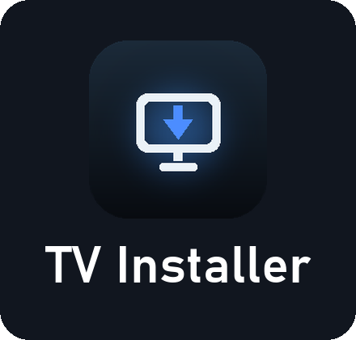
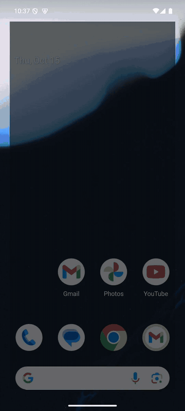

<b>Samsung Smart TV</b>ga ilovalarni to'g'ridan-to'g'ri Android telefondan o'rnating. Kompyuter, Tizen Studio va simlarsiz.

&nbsp;&nbsp;&nbsp;&nbsp;&nbsp;<a href="README.md"> English</a>&nbsp;&nbsp;&nbsp;<a href="README.ru.md"> Русский</a>&nbsp;&nbsp;&nbsp; <b>O'zbekcha</b>

Bepul · Android 7.0+ · <a href="CHANGELOG.md">Yangiliklar</a> · <a href="https://sunic007.github.io/tvinstaller/privacy.html">Maxfiylik</a>

 

## Qanday ishlaydi

1. <b>TV Installer'ni o'rnating</b> — yuqoridagi tugma orqali APK'ni yuklab oling va telefonda oching.
2. <b>Samsung hisobiga kiring</b> — bir marta. Televizor uchun sertifikatni Samsung o'zi beradi.
3. <b>Televizorni tayyorlang</b> — dasturchi rejimini telefon manzili bilan yoqing. <a href="https://youtu.be/AB0fsIuFSII">1 daqiqalik video</a>.
4. <b>Ulaning</b> — ilova televizorni Wi‑Fi tarmog'ingizda o'zi topadi.
5. <b>O'rnating</b> — katalogdan (40+) ilovani tanlang va <b>O'rnatish</b>ni bosing.

  
  
  

 

<b>Ko'proq skrinshotlar</b>

 

  
  
  
  
  
  

## Imkoniyatlar

- <b>Televizorni o'zi topadi</b> — bir xil Wi‑Fi tarmog'ida; bir nechta televizor bilan ishlash mumkin.
- <b>«Ulanmayaptimi?» yordamchisi</b> — Wi‑Fi, televizor, dasturchi rejimi va televizordagi manzilni bosqichma-bosqich tekshiradi va televizor boshqa qurilmaga sozlangan bo'lsa, buni aniq aytadi.
- <b>Samsung sertifikati bir marta</b> — Samsung hisobi orqali. Muddati tugashidan bir oy oldin eslatma, bir bosishda yangilash, zaxira nusxa va tiklash.
- <b>40+ ilovali katalog</b> — mediatekalar, pleyerlar, striming, IPTV va «Tavsiya etamiz» — yoki o'zingizning <code>.wgt</code> faylingiz va havola.
- <b>Bir bosishda o'rnatish</b> — har bir qadam ekranda. «TV'da» ro'yxatida — «Ochish», «O'chirish» va «Hammasini yangilash», kuniga bir marta yangilanishlar haqida bildirishnoma.
- <b>Pult</b> — telefoningizda va televizorni tarmoq orqali yoqish (Wake‑on‑LAN).
- <b><a href="https://github.com/sunic007/lampa-samsung">Lampa for Samsung</a></b> — GitHub'dagi oxirgi relizdan o'rnatiladi va keyin televizorda o'zi yangilanadi.
- <b>O'zini yangilaydi</b> — brauzersiz: yangi versiyani yuklab oladi, tekshiradi va Android o'rnatuvchisini ochadi.

## Nima kerak

- Android 7.0+ telefon va Tizen'li Samsung Smart TV — bir xil Wi‑Fi tarmog'ida (mehmon tarmog'i emas).
- Bepul Samsung hisobi — o'rnatish sertifikati uchun.

## Ko'p beriladigan savollar

<b>Televizor topilmayapti yoki ulanmayapti</b>

 

⋮ menyusi → <b>Ulanmayaptimi?</b> — yordamchi hammasini bosqichma-bosqich tekshiradi. Telefon va televizor bir tarmoqda ekanini va televizordagi dasturchi rejimida <i>aynan shu</i> telefonning IP manzili yozilganini tekshiring. IP o'zgargan bo'lsa, uni qayta kiriting va televizorni qayta yoqing.

<b>Imzolash yoki o'rnatish xatosi</b>

 

Ilovaning eski versiyasini televizordan o'chirib, qaytadan o'rnating.

<b>Xavfsizmi?</b>

 

Ilova televizor bilan faqat uy tarmog'ingiz ichida ishlaydi. Samsung'ga faqat sertifikat uchun, GitHub'ga esa ilovalarni yuklab olish uchun murojaat qiladi — batafsil <a href="https://sunic007.github.io/tvinstaller/privacy.html">maxfiylik siyosatida</a>.

## Loyihani qo'llab-quvvatlash

TV Installer bepul. Foydali bo'lsa, rivojlanishini <a href="https://github.com/sponsors/sunic007"><b>GitHub Sponsors</b></a> orqali qo'llab-quvvatlashingiz mumkin.

---

TV Installer — mustaqil loyiha, Samsung bilan bog'liq emas va u tomonidan tasdiqlanmagan. Samsung va Tizen — Samsung Electronics'ning savdo belgilari. Ilova sertifikatni Samsung'ning Tizen Studio'si kabi usulda oladi: siz o'z Samsung hisobingizga kirasiz, sertifikatni televizoringiz uchun Samsung beradi. O'rnatilgan ilovalar uchun foydalanuvchi javobgar; ilovaning o'zi hech qanday media kontentni saqlamaydi va taqdim etmaydi.
