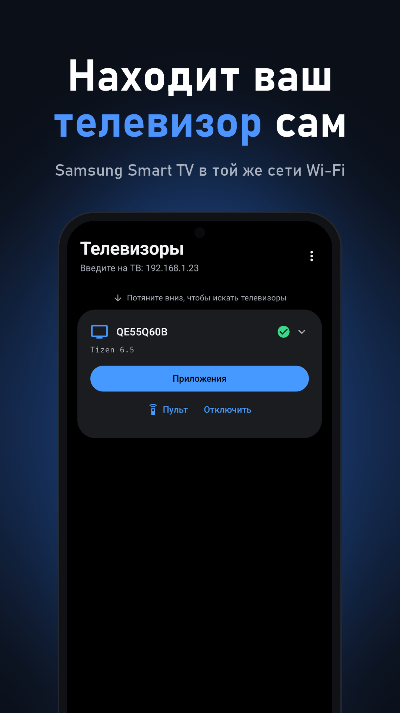
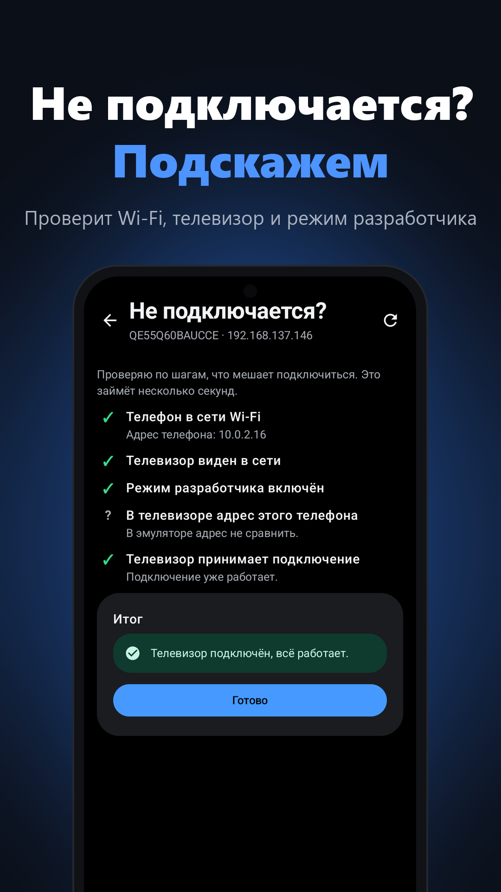
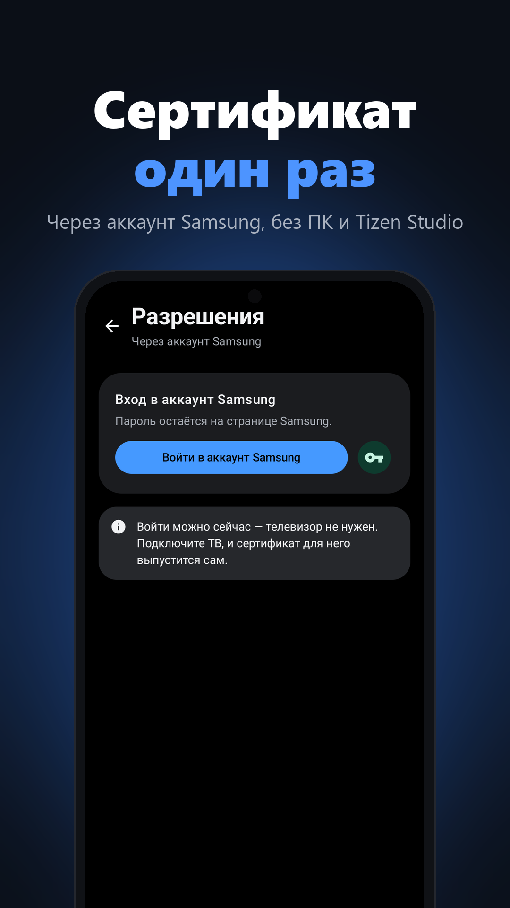
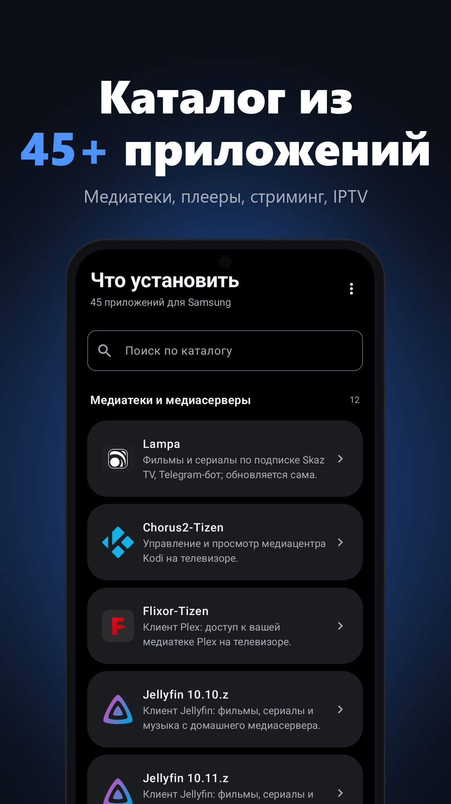
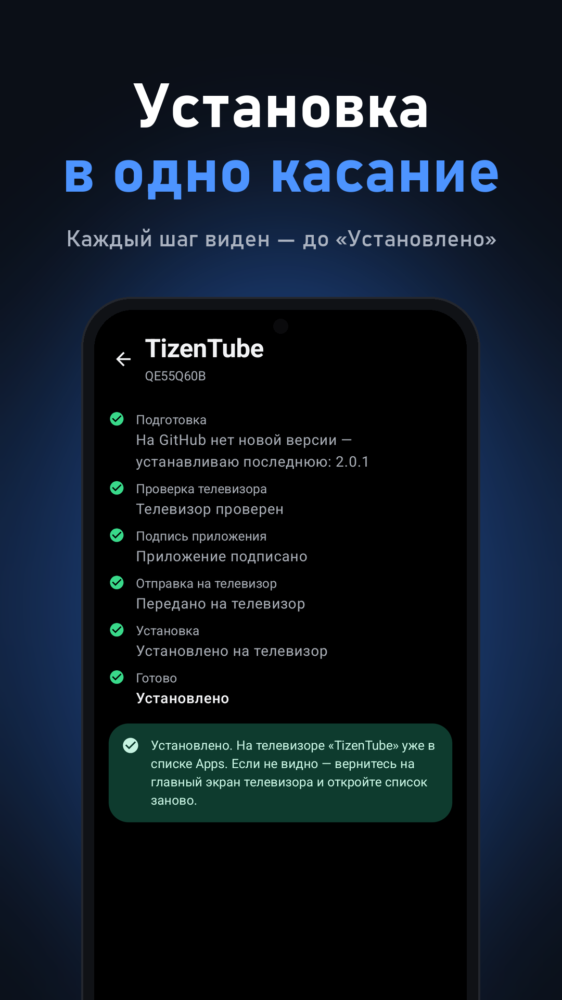
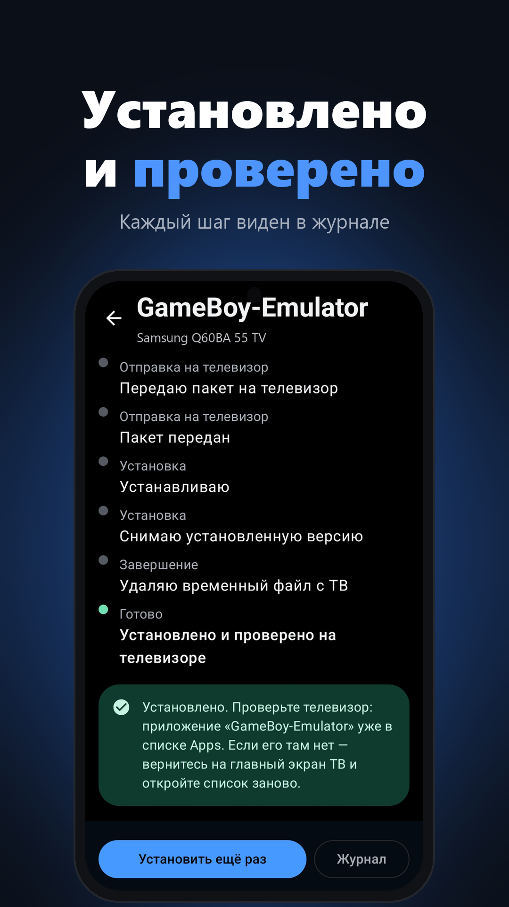
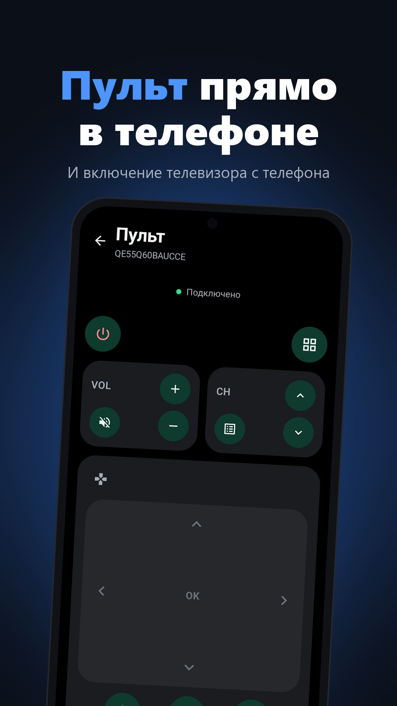

# TV Installer — установка приложений на Samsung Smart TV с телефона

    

[English](README.md) · **Русский**

Android-приложение для установки приложений `.wgt` на телевизоры **Samsung (Tizen)** прямо с телефона — без компьютера
и Tizen Studio. Подписывает пакет само и ставит его на ТВ по Wi-Fi.

**⬇️ [Скачать TvInstaller.apk](https://github.com/sunic007/tvinstaller/releases/latest/download/TvInstaller.apk)** — последняя версия
· все версии — [Releases](https://github.com/sunic007/tvinstaller/releases)
· [политика конфиденциальности](https://sunic007.github.io/tvinstaller/privacy.html)
· ❤️ [поддержать проект](https://github.com/sponsors/sunic007)

Главное приложение в каталоге — **[Lampa для Samsung](https://github.com/sunic007/lampa-samsung)**: TV Installer
ставит её последнюю версию прямо из релизов GitHub, дальше она обновляется на телевизоре сама.

  
  
  
  

  
  
  

## Что нужно

- Телефон на Android и телевизор Samsung с Tizen — в одной Wi-Fi сети.
- Файл `.wgt` — например, [Lampa для Samsung](https://github.com/sunic007/lampa-samsung/releases/latest/download/samsung.wgt).

## Как установить приложение на ТВ

1. **IP телефона** TV Installer показывает сам — вверху экрана «Телевизоры».
2. **Включите режим разработчика на ТВ:** откройте вкладку **Apps** (Приложения) → внизу **App Settings** →
   наберите на пульте `1 2 3 4 5` → включите **Developer mode**, впишите IP телефона и нажмите **OK**.
   Перезагрузите телевизор (кнопку питания держать ~2 секунды). В приложении это показано анимацией по шагам.
3. **Установите TV Installer** на телефон: скачайте APK и откройте его (Android попросит разрешить установку из
   этого источника).
4. В TV Installer выберите **телевизор** и **файл `.wgt`** — приложение подпишет пакет и установит его.
5. Новые версии ставятся поверх старых, настройки приложения на ТВ сохраняются.

## Частые вопросы

**ТВ не находится.** Проверьте, что телефон и ТВ в одной сети, а в режиме разработчика на ТВ указан IP именно
телефона. После смены IP — снова перезагрузите ТВ.

**Ошибка подписи или установки.** Удалите старую версию приложения на ТВ и установите заново.

**Безопасно ли.** Приложение работает только в вашей домашней сети, данные никуда не отправляет — подробнее в
[политике конфиденциальности](https://sunic007.github.io/tvinstaller/privacy.html).

## Отказ от ответственности

TV Installer — независимый проект, не связан с Samsung и не одобрен ею. Samsung и Tizen — товарные знаки Samsung
Electronics. Приложение использует тот же способ получения сертификата, что и Tizen Studio от Samsung: вы входите в
свой аккаунт Samsung, и сертификат для вашего ТВ выдаёт Samsung. За устанавливаемые приложения отвечает пользователь;
само приложение не хранит и не предоставляет медиаконтент.

## Поддержать проект
TV Installer бесплатный. Поддержать развитие можно на **[GitHub Sponsors](https://github.com/sponsors/sunic007)**
(в приложении: «Настройки → Поддержать проект»).
