[English](README.md) · [Русский](README.ru.md) · **O'zbekcha**

# TV Installer — Samsung Smart TV'ga telefondan ilova o'rnatish

   

**Samsung (Tizen)** televizorlariga `.wgt` ilovalarni to'g'ridan-to'g'ri telefondan o'rnatadigan Android ilova —
kompyuter va Tizen Studio kerak emas. Televizorni Wi‑Fi tarmog'ida o'zi topadi, Samsung sertifikatini oladi, paketni
imzolaydi va o'rnatadi.

**⬇️ [TvInstaller.apk'ni yuklab olish](https://github.com/sunic007/tvinstaller/releases/latest/download/TvInstaller.apk)** — oxirgi versiya
· barcha versiyalar — [Releases](https://github.com/sunic007/tvinstaller/releases)
· yangiliklar — [CHANGELOG.md](CHANGELOG.md)
· [maxfiylik siyosati](https://sunic007.github.io/tvinstaller/privacy.html)
· ❤️ [loyihani qo'llab-quvvatlash](https://github.com/sponsors/sunic007)

> Ilova **o'zbek, rus va ingliz** tillarida ishlaydi: telefon tiliga moslashadi, tilni Sozlamalar → Язык · Language ·
> Til bo'limida o'zgartirish mumkin.

  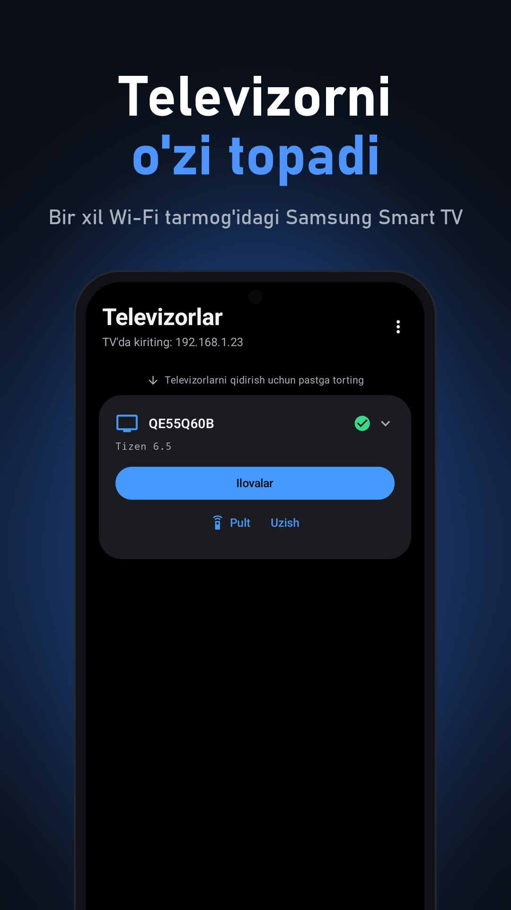
  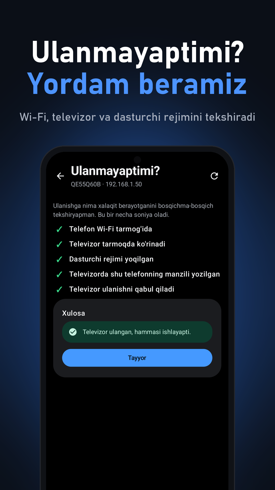
  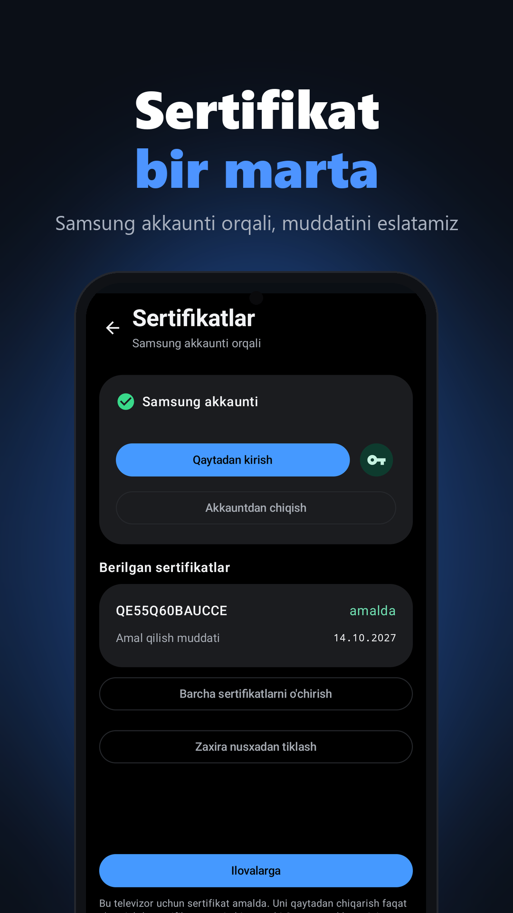

Ko'proq skrinshotlar

  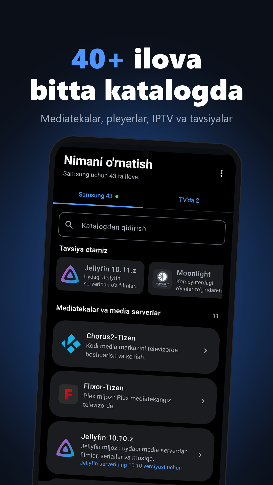
  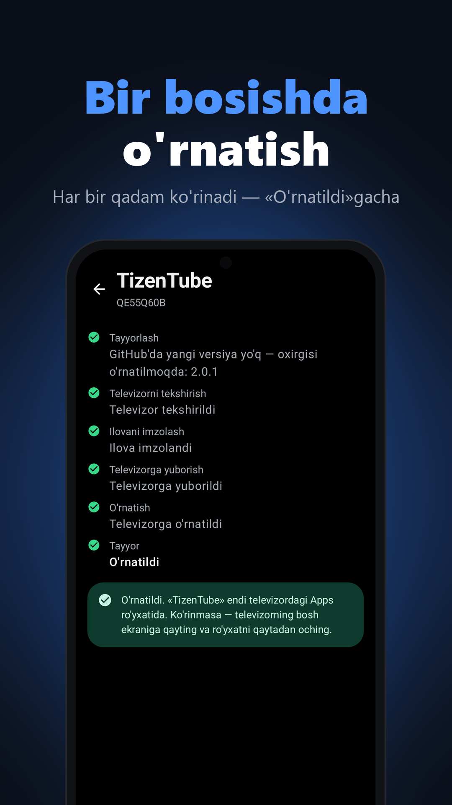
  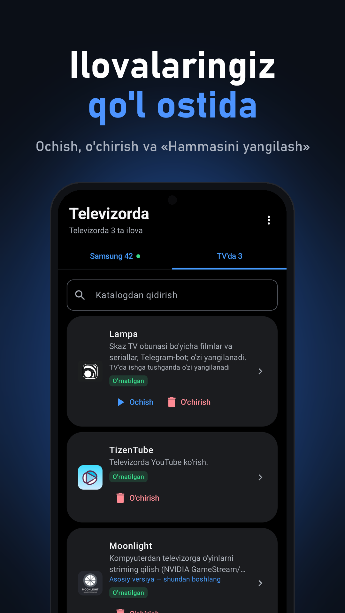

  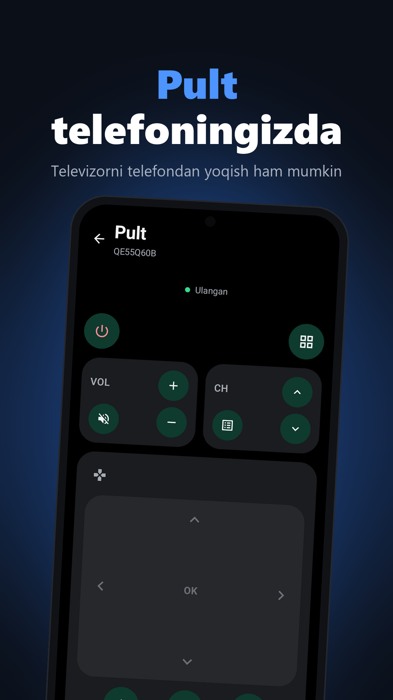
  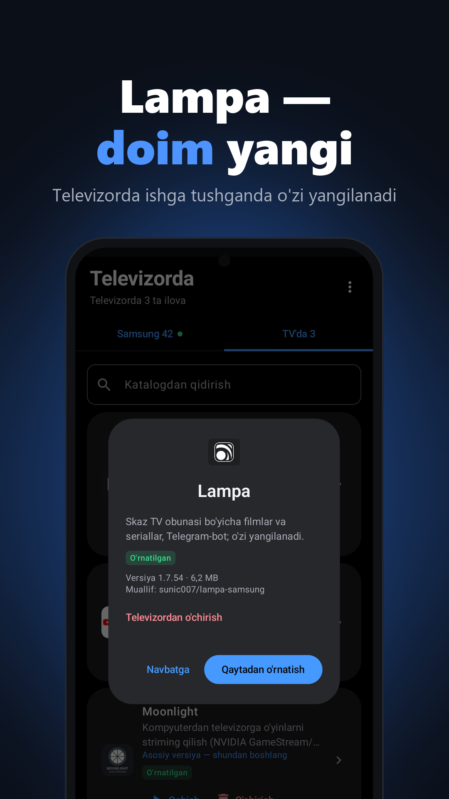
  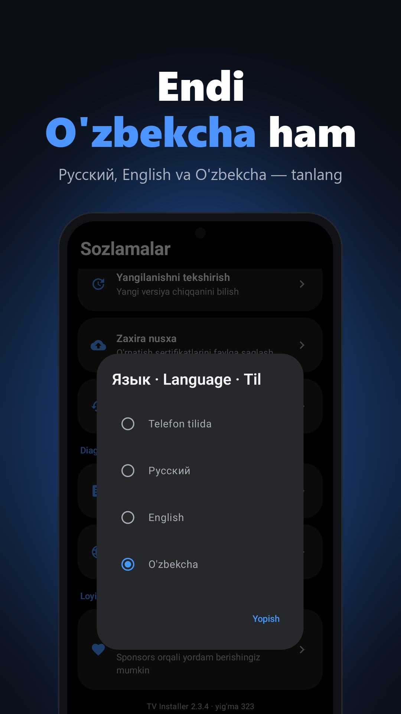

## Imkoniyatlar

- **Televizorni o'zi topadi** — bir xil Wi‑Fi tarmog'ida; bir nechta televizor bilan ishlash mumkin.
- **«Ulanmayaptimi?» yordamchisi** Wi‑Fi, televizor, dasturchi rejimi va televizordagi manzilni bosqichma-bosqich
  tekshiradi. Televizor boshqa qurilmaga sozlangan bo'lsa, buni aniq aytadi (Samsung televizoriga bir vaqtda faqat
  bitta telefon yoki kompyuter ilova o'rnata oladi).
- **Sertifikat bir marta olinadi** — Samsung akkaunti orqali, kompyutersiz. Muddati tugashidan bir oy oldin eslatma
  keladi, yangilash — bir bosishda; zaxira nusxa saqlash va **zaxiradan tiklash** mumkin.
- **40+ ilovali katalog** — mediatekalar, pleyerlar, striming, IPTV — va **«Tavsiya etamiz»** to'plami. O'zingizning
  `.wgt` faylingizni yoki havolani ham o'rnatish mumkin.
- **Bir bosishda o'rnatish**: har bir qadam ko'rinadi, oxirida — **«TV'da ochish»**. **«TV'da»** ro'yxatida —
  **«Ochish / O'chirish»** va **«Hammasini yangilash»**; yangilanishlar chiqsa, kuniga bir marta bildirishnoma keladi.
- **Pult telefoningizda** va **televizorni telefondan yoqish** (Wake-on-LAN).
- **[Lampa for Samsung](https://github.com/sunic007/lampa-samsung)** GitHub'dagi oxirgi relizdan o'rnatiladi va keyin
  televizorda o'zi yangilanadi.
- **Brauzersiz o'zini yangilaydi**: yangi versiyani o'zi yuklab oladi, tekshiradi va Android o'rnatuvchisini ochadi.

## Nima kerak

- Android 7.0+ telefon va Tizen'li Samsung Smart TV — bir xil Wi‑Fi tarmog'ida (mehmon tarmog'i emas).
- Bepul Samsung akkaunti (o'rnatish sertifikati uchun).

## Televizorga ilova qanday o'rnatiladi
<table>
<tr>
<td valign="middle">

<b>Video qo'llanma</b> 
muqovani bosing va tomosha qiling

</td>
<td align="right" valign="middle">

<a href="https://youtu.be/AB0fsIuFSII">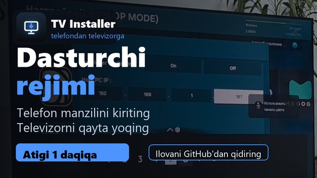</a>

</td>
</tr>
</table>

Boshqa tillar

<a href="https://youtu.be/U4VGa0fGYUI">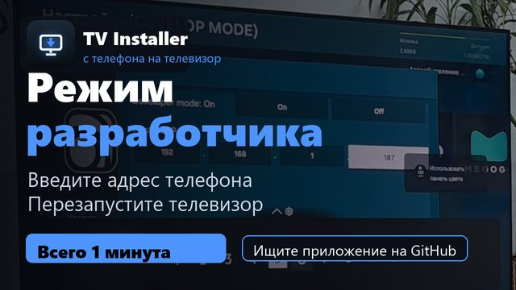</a> <a href="https://youtu.be/L6nK4SBWKP0">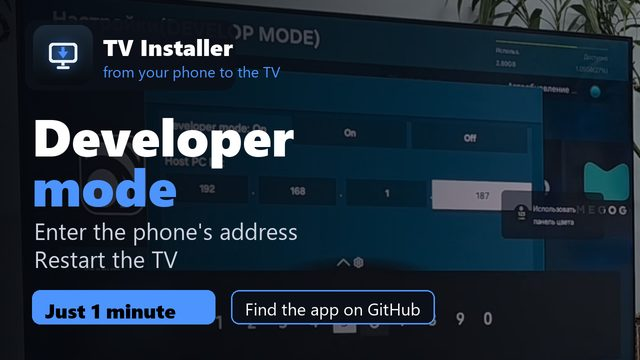</a>

1. **Televizorda dasturchi rejimini yoqing:** **Apps** bo'limini oching → pastda **App Settings** → pultda
   `1 2 3 4 5` ni tering → **Developer mode**'ni **On** qiling, telefon IP manzilini kiriting (TV Installer uni
   «Televizorlar» ekranining tepasida ko'rsatadi) va **OK** ni bosing.
2. **Televizorni qayta yoqing:** yoqish tugmasini ~2 soniya bosib turing. Qayta yoqilgandan keyin **App Settings**
   tepasida **DEVELOP MODE** yozuvi chiqadi.
3. **TV Installer'ni** telefonga o'rnating: APK'ni yuklab oling va oching (Android bu manbadan o'rnatishga ruxsat
   so'raydi).
4. TV Installer'da **televizorni** tanlang, sertifikat uchun bir marta **Samsung**'ga kiring va katalogdan ilova yoki
   o'z `.wgt` faylingizni tanlang.
5. Yangi versiyalar eskisining ustidan o'rnatiladi, ilovaning televizordagi sozlamalari saqlanadi.

## Ko'p beriladigan savollar

**Televizor topilmayapti yoki ulanmayapti.** ⋮ menyusi → «Ulanmayaptimi?» — yordamchi hammasini bosqichma-bosqich
tekshiradi. Telefon va televizor bir tarmoqda ekanini, televizordagi dasturchi rejimida aynan shu telefonning IP manzili
yozilganini tekshiring. IP o'zgargan bo'lsa, uni qayta kiriting va televizorni qayta yoqing.

**Imzolash yoki o'rnatish xatosi.** Ilovaning eski versiyasini televizordan o'chirib, qaytadan o'rnating.

**Xavfsizmi?** Ilova televizor bilan faqat uy tarmog'ingiz ichida ishlaydi. Samsung'ga faqat sertifikat uchun, GitHub'ga
esa ilovalarni yuklab olish uchun murojaat qiladi — batafsil [maxfiylik siyosatida](https://sunic007.github.io/tvinstaller/privacy.html).

## Javobgarlikdan voz kechish

TV Installer — mustaqil loyiha, Samsung bilan bog'liq emas va u tomonidan tasdiqlanmagan. Samsung va Tizen — Samsung
Electronics'ning savdo belgilari. Ilova Samsung'ning Tizen Studio'si kabi sertifikat olish usulidan foydalanadi: siz
o'z Samsung akkauntingizga kirasiz, sertifikatni televizoringiz uchun Samsung beradi. O'rnatilgan ilovalar uchun
foydalanuvchi javobgar; ilovaning o'zi hech qanday media kontentni saqlamaydi va taqdim etmaydi.

## Loyihani qo'llab-quvvatlash

TV Installer bepul. Foydali bo'lsa, rivojlanishini **[GitHub Sponsors](https://github.com/sponsors/sunic007)** orqali
qo'llab-quvvatlashingiz mumkin (ilovada: Sozlamalar → Loyihani qo'llab-quvvatlash).
